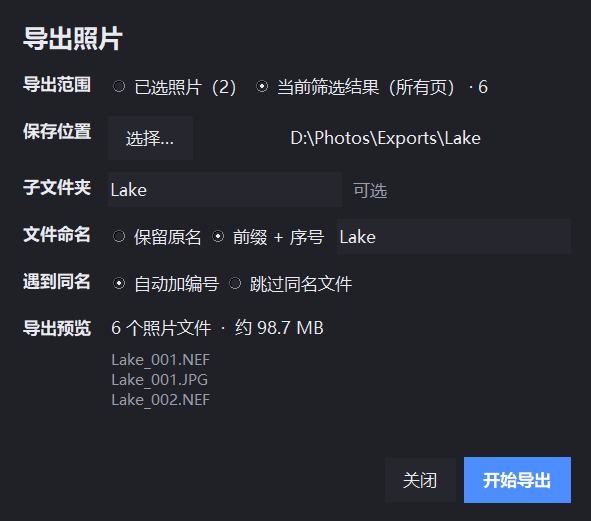

# PhotoClassifier

[English](README.md) | [简体中文](README.zh-CN.md)

面向摄影工作流的 RAW 照片智能整理与筛选工具。

一次拍摄动辄产生数百上千张照片：RAW、JPEG、视频混在一起，还有损坏文件和重复照片。
传统的"按日期分文件夹"回答不了这样的问题——

> "我现在想修所有夜景建筑照片。"

PhotoClassifier 的目标是：**扫描并理解照片的信息（EXIF / 文件 / 将来的图像分析），
让摄影师能按"我现在想处理什么"来快速找到照片**，然后把选出的照片交给
Lightroom 等后期软件。

## Windows 安装

1. 在 Windows 10 或 11（x64）上，从 [GitHub Releases](https://github.com/mic221218-blip/PhotoClassifier/releases/latest) 下载 `PhotoClassifier-Setup-x64.exe`。
2. 双击安装包，按向导选择 **Next → Install → Finish**。安装包已包含 Python 和运行依赖，默认仅为当前 Windows 用户安装。
3. 从开始菜单打开 **PhotoClassifier**。在左侧加入照片文件夹，再点 **开始扫描**。

安装包尚未签名。如果 Windows 显示 SmartScreen 提示，确认文件来自上述 GitHub Release 后，可以选择 **更多信息 → 仍要运行**。

**升级和图库。** 退出程序后运行新版安装包。图库和标签保存在 `%LOCALAPPDATA%\PhotoClassifier\photos.db`。
如需迁移源码版的图库，先退出两个版本并备份数据库，再将源码目录下的 `data/photos.db` 复制到该位置。
可在 Windows **设置 → 应用** 中卸载程序。

**可选 AI。** 人物和天空分析需要另行准备模型文件。按[人物和天空 AI 试用](#人物和天空-ai-试用)中的相对路径，
把模型放在 `%LOCALAPPDATA%\PhotoClassifier\models` 下。安装包已包含推理运行库。

## 项目定位

- PhotoClassifier **不是 Lightroom 的替代品**，而是 Lightroom **之前**的照片分析与筛选工具；
- 分类结果存储在数据库里，原始照片保留在原位置。确认导出后，程序会把已选照片或当前筛选结果复制到指定文件夹。
- 核心工作流：`相机 → 照片文件夹 → PhotoClassifier（扫描 + 分析 + 筛选 + 导出）→ Lightroom（后期）`。

## 核心设计思想

1. **一张照片 ≠ 一个分类。** 一张夜景建筑照片可以同时属于 `#夜景`、`#建筑`、`#城市`，
   因此采用"多标签 / 多属性"模型，而不是把照片扔进某一个文件夹。
2. **原始文件只保留一份。** 标签和属性记录在数据库中，不因为多个分类而复制 RAW 文件。
3. **原片安全优先。** 默认只做"读取 → 分析 → 建库 → 筛选"，绝不自动删除、修改或移动原片。
4. **单个文件出错不能拖垮整个任务。** 3000 张里第 1532 张损坏？记录错误、跳过、继续，
   最后给出完整报告。
5. **AI 是可插拔的增强，不是核心依赖。** 能用 EXIF 和规则解决的，不引入 AI；
   未来的视觉识别再按需加入。

## 当前功能（V3）

### V1：文件扫描与 NEF 基础支持 ✅

- 递归扫描任意真实摄影文件夹（支持 NEF / JPEG / PNG 混合存放）；
- 按扩展名识别文件类型（大小写不敏感）：NEF、JPEG、PNG、视频（MOV / MP4 等）、未知格式；
- 视频与未知格式只记录文件信息，不参与照片分析，也不会导致程序崩溃；
- 扫描完全只读，不改动任何原始文件。

### V1.5：EXIF 与照片信息 ✅

- **零依赖的 EXIF 解析器**（`src/exif_reader.py`）：直接解析 NEF（TIFF 结构）
  和 JPEG（APP1 段），读取——
  - 拍摄时间、相机（厂商 + 型号）、镜头型号
  - 焦距、光圈、快门速度、ISO、曝光补偿
  - GPS 坐标（十进制度）
  - 图片尺寸
  - 同时支持大端 / 小端字节序的 TIFF；
- **SQLite 照片信息数据库**（`src/database.py`）：以文件绝对路径为唯一键，
  重复扫描时更新而不是重复插入，不需要任何第三方依赖；
- **容错分级**：能区分"文件损坏"（标记异常）、"没有 EXIF"（正常处理，只是缺信息）、
  "非照片文件"（只记录文件信息）三种情况；
- **命令行工具**（`src/main.py`）：
  - `scan`：扫描文件夹 → 读 EXIF → 写数据库 → 打印扫描报告；
  - `show`：查看数据库中的照片记录（支持按文件名 / 路径模糊查找）；
  - `stats`：数据库统计（按文件类型 / EXIF 状态 / 相机 / 镜头）。

### 桌面界面 ✅

- **文件夹库**：点左侧文件夹浏览，或用「全部照片」查看整个库。扫描范围独立，在「更多 → 扫描范围」里选择；
- **后台扫描**：进度条 + 当前文件 + 实时成功/异常计数，可随时取消；
- **照片网格**：默认显示缩略图，方向键浏览，空格或双击看大图。可切换到列表查看 EXIF 等完整列，双击列表行用系统默认程序打开；
- **延时叠**：扫描后按 EXIF 拍摄节奏自动识别同一文件夹内的长序列。10 帧及以下逐张显示，同名 NEF 和 JPEG 算一帧。原片留在原位，网格和列表默认显示一张封面及帧数。双击叠卡按拍摄时间展开，右键可选中整叠或打开原文件夹。上方「延时叠」只看延时，「折叠延时」切换折叠显示；
- **详情面板**：可收起。预览和标签直接显示，点击「拍摄参数与分析」查看完整参数、质量数据和规则命中原因；
- **筛选与质量分析**：网格上方可以快速切换「全部」「精选」「质量问题」「重复组」。「筛选组」只显示延时叠之外的照片，方便逐张挑选。「筛选」里的拍摄规则、质量标记、我的标签和 AI 建议可以组合，也可和「筛选组」搭配使用。运行质量分析用「更多 → 质量分析」；
- 在「筛选」面板顶部勾选 **只看 RAW**，只显示 RAW 原片（目前支持 NEF）。此选项可和现有筛选组合使用。折叠的延时叠按可见 RAW 帧显示数量，选中整叠也只选这些 RAW。
- **清晰度排序（P1）**：结果标题栏「清晰度优先」按钮，按 `blur_score`
  从高到低排列；新增「清晰度」数值列；未分析 / 视频 / 分析失败排在最后；
  排序只影响当前显示顺序，关闭程序后不保留；
- **快捷精选（P2）**：点「标记精选」或按 `P`，当前操作的照片全已精选时按钮变为「取消精选」，`Ctrl+Z` 可撤销；
- **我的标签（V3）**：「筛选」内有搜索和勾选列表（带照片数），详情面板可编辑标签；
  结果行右键批量添加/移除、单步撤销；标签管理对话框；
- 缩略图和大图预览需要 Pillow（见 `requirements-quality.txt`），支持 JPEG、PNG 和带内嵌 JPEG 的 NEF；
- 启动方式：桌面快捷方式（指向 `run_gui.pyw`），或
  `python -m src.gui` / `pythonw run_gui.pyw`。

#### 导出照片到 Lightroom

1. 点结果区的「导出…」，范围默认为当前筛选结果的所有页。打开延时叠后，范围为叠内照片。若只想导出勾选的照片，点多选工具栏的「导出所选照片…」。
2. 在「保存位置」选择文件夹，按需填写子文件夹名。保留原名，或选「前缀 + 序号」。同一目录下的同名 NEF 和 JPEG 都在范围内时，共用序号。遇到重名，可让整对文件一起加编号或一起跳过。
3. 核对目标路径、文件总数、预计大小和文件名示例，点「开始导出」。程序原样复制 NEF、JPEG 和 PNG，跳过已经位于目标文件夹的原片，并记住本次的基础文件夹和命名方式。
4. 中途点「取消导出」，程序会处理完当前文件或配对文件，保留已完成的副本。有失败项可点「重试失败项」。点「打开导出文件夹」查看副本，再从 Lightroom 导入该文件夹。



### V2：规则分类 ✅

- **6 条内置 EXIF 规则**（阈值全部可配置，集中在 `src/rules.py` 的 `RuleConfig`）：
  - 夜景：拍摄时间落在夜间时段（默认 18:00–06:00）
  - 高感：ISO ≥ 3200；慢门：快门慢于 1/30s；长焦：焦距 ≥ 70mm
  - 广角：焦距 ≤ 24mm；大光圈：光圈 ≤ f/2.8
- **可解释**：每次命中都生成带实际数值的原因，如 `ISO 6400 ≥ 3200`、
  `焦距 120 mm ≥ 70 mm`；
- **EXIF 缺失不报错**：字段为空时规则不命中，照片仍保留在全部照片视图中；
- **一张照片可以同时命中多条规则**（对应"一张照片、多个标签"的设计思想）；
- **CLI**：`classify`（规则统计报告）+ `filter`（按规则筛选，支持 AND/OR、
  `--explain` 展开原因、`--gps` 只看有 GPS 的照片）；
- **GUI**：筛选面板的复选框已接入规则引擎，勾选后**实时筛选**结果列表；
  结果列表新增「自动标签」列（chips）；详情面板显示「规则命中」原因；
  支持「有 GPS 坐标」筛选。

### V2.5：图像质量分析 ✅

项目**第一次读取像素**。`analyze` 时把画质测量写进数据库，判定仍然是实时的——
改阈值不需要重新解码图片。

- **像素来源**：NEF 取**内嵌的 JPEG 预览**（IFD0 / SubIFD，实测 6048×4032），
  JPEG / PNG 直接解码；**不做 RAW 解码**，因此不需要 libraw / rawpy；
- **6 项能力**：模糊、运动模糊、过曝、欠曝、黑屏、重复照片；
- **可解释**：每个标记都带具体数值，例如
  `清晰度 116 < 120（拉普拉斯方差，512px）`、`高光截断 21% ≥ 12%`；
- **重复检测**：精确重复（同尺寸 + 首尾 256KiB 指纹先行筛选，撞车才整文件
  SHA-256）+ 近似重复（dHash ≤ 8 且拍摄时间差 ≤ 10s）；
- **延时 / 连拍序列**：按拍摄节奏识别（间隔 ≤ 12s、≥ 20 帧、≥ 60s）的长序列；
  序列内的相似帧只报告、**不标记为重复**；含序列的文件夹默认同样豁免
  （`--strict` 可关闭）。这是用真实延时素材校准出来的规则；
- **同名 RAW+JPEG 不算重复**（同一张照片的两种格式，dHash 完全相同）；
- **CLI**：`analyze`（分析 + 报告 + `--csv` 导出测量值用于校准）、
  `quality`（统计与标记清单）、`dupes`（重复分组，`--sequences` 附带序列）、
  `filter --quality`（与规则共用 AND/OR）、`filter --quality-ok`
  （只看没有技术问题的照片；重复单独判断）；
- **GUI**：筛选面板新增「质量分析」6 个复选框 + **「只看质量正常」**
  （排除模糊/运动/曝光/黑屏，不把重复算进去）、结果列表新增「质量」列
  （正常 / 模糊 / 过曝…）、详情面板显示清晰度 / 亮度 / 截断 / 重复与原因、
  工具栏新增「质量分析」按钮（后台线程 + 进度 + 可取消 + 增量）；
- **可选依赖**：质量分析需要 Pillow（`requirements-quality.txt`）；没安装时
  扫描、EXIF、规则分类与规则筛选**完全不受影响**。

### V3：多标签系统 ✅（当前版本）

每张照片可以拥有任意多个**扁平标签**：规则/质量是系统标签（实时派生），
用户标签持久化在 SQLite，两者在界面与筛选里统一使用。

- **数据模型**：新增 `tags` + `photo_tags`（schema `1 → 2`，纯加法迁移）；
  名称大小写不敏感唯一、自动配色、删除标签会级联移除关联（不删照片）；
- **单张编辑**：详情面板「我的标签」彩色 chips + 输入框 + 自动补全；
  点 × 移除；输入新名称时确认后创建；
- **批量**：结果表多选 + 右键菜单（打开图片 / 打开文件位置 / 添加标签… /
  移除标签… / 复制路径 / **从照片库移除…**），操作前显示数量，完成后可用
  **Ctrl+Z 单步撤销**；删除键同样可以移除选中记录（只删数据库，不删磁盘文件）；
- **筛选**：「筛选 → 我的标签」支持搜索、勾选、显示照片数；与规则/质量共用
  同一个「并且 / 或者」（统一实现在 `src/filtering.py`）；
- **展示**：结果列里用户标签以 `★` 前缀排在最前，
  例如 `★建筑 ｜ 夜景 · 慢门`（保证用户标签不会被长名称挤掉）；
  详情面板使用彩色 chips；
- **管理**：标签管理对话框（新建 / 重命名 / 删除，删除前显示影响数量）；
- **预置标签**：首次升级预置 10 个常用标签（风光/建筑/夜景/人物/天空/水面/
  城市/运动/花卉/日落），不自动打标，可删除；
- **CLI**：`tags`、`tag add/remove/list/rename/delete`、`filter --tags`；
  `show` 会显示照片的标签。

## 从源码运行

### 人物和天空 AI 试用

点缩略图左上角的复选框，或点「多选」后点击照片。Ctrl＋点击可切换单张，Shift＋点击可选中本页的连续范围。翻页会保留已选照片，也可以点「全选本页」。点「清除选择」或按 Esc 会退出多选。修改筛选条件时，仍符合条件的照片会保持选中。

选好照片后，点「AI 分析 → 六类题材主次」，一次分析人物、天空、建筑、城市、花卉和风光。程序结合整幅画面的内容、各元素所占面积、位置和局部细节，把识别到的题材分为主要内容、次要内容和背景元素。两个主体都突出时可以并列。也可以单独运行原有的「人物」「天空」或「人物和天空」。如果选中项中包含视频，菜单按钮会显示实际可分析的张数。

在「筛选 → AI 建议」勾选题材，例如「人物」，人像会排在仅有背景路人的照片前面。同档沿用当前排序，右侧详情显示每个命中题材的主次。多选仍支持「并且 / 或者」。只做过单项分析的照片可以继续筛选，排在已分档的命中之后。运行六类分析后以六类结果为准。结果保存在本地照片库，与手动标签独立。取消会保留已完成的结果。支持 JPEG、PNG 和带内嵌预览的 NEF。

「扫描新文件」复用文件大小和精确修改时间一致的记录。「更多 → 全量重扫」会重新读取扫描范围内的文件。命令行对应选项是 `scan --full`。

人物分析需要 `requirements-ai.txt` 中的可选依赖和 `models/` 中的 YOLOX-Tiny 与 CLIP ViT-B/32 int8 模型。`.dsh_work/models/` 中已有的同结构缓存也可以使用。模型的相对路径为 `yolox_tiny.onnx`、`clip/int8/vision_model_int8.onnx`、`clip/int8/text_model_int8.onnx` 和 `clip/tokenizer.json`。

天空分析使用同一份可选依赖和本地 `models/segformer-b0/model.onnx`，也支持 `.dsh_work/models/` 中的同结构缓存。试用采用指定的 SegFormer-B0 ONNX 权重，按上游的研究和评测许可使用。[权重文件](https://huggingface.co/Xenova/segformer-b0-finetuned-ade-512-512/blob/main/onnx/model.onnx) · [上游许可](https://github.com/NVlabs/SegFormer/blob/master/LICENSE)

「六类题材主次」同时使用上述人物和天空模型。使用单项分析的旧照片需要运行一次六类分析才能得到主次。

要求：Python 3.12+。核心功能只用标准库；**图像质量分析需要可选的 Pillow**：

```bash
pip install -r requirements-quality.txt
```

不安装 Pillow 时，`analyze` 会给出安装提示，其余功能照常可用。

```bash
# 1. 创建并激活虚拟环境（Windows PowerShell）
python -m venv .venv
.venv\Scripts\Activate.ps1

# 2. 扫描一个真实照片文件夹（数据库默认写入 data/photos.db）
python -m src.main scan "D:\Photos\2026"

# 3. 查看某张照片的完整信息
python -m src.main show --match DSC_0012

# 4. 查看统计
python -m src.main stats

# 5. 规则分类统计（V2）
python -m src.main classify

# 6. 按规则筛选（V2）：夜景 且 高感，展开命中原因
python -m src.main filter --rules night,high_iso --explain

# 7. 夜景 或 长焦；或只看有 GPS 的照片
python -m src.main filter --rules night,telephoto --or
python -m src.main filter --gps

# 8. 分析图像质量（增量；只读，不改动任何照片）
python -m src.main analyze

# 9. 质量统计；只看模糊并展开原因
python -m src.main quality
python -m src.main filter --quality blurry --explain

# 10. 重复照片分组（附带延时/连拍序列）
python -m src.main dupes --sequences

# 11. 安装 / 更新桌面快捷方式（Windows）
python tools/install_shortcut.py

# 12. 用户标签（V3）
python -m src.main tags
python -m src.main tag add --tag 建筑 --tag 待修 "D:\Photos\2026\DSC_0012.NEF"
python -m src.main tag add --tag 建筑 --match 金鸡湖
python -m src.main tag list --tag 建筑
python -m src.main filter --tags 建筑
python -m src.main filter --rules night --tags 建筑
python -m src.main filter --quality-ok
python -m src.main tag rename 待修 待精修
python -m src.main tag delete 待精修 --yes
```

`scan` 的输出报告（对应规划文档的容错设计）：

```
扫描完成
根目录：D:\Photos\2026
总文件：9
成功处理：
  NEF：3（含 EXIF：3）
  JPEG：2（含 EXIF：1）
  PNG：1
跳过：
  视频：1
  其他：1
异常：
  NEF：1
照片信息数据库：data\photos.db（本次写入 9 条，合计 9 条）
任务完成。
```

`analyze` 的真实输出（2026-10-19，1,375 个文件的延时素材）：

```
质量分析完成（候选 1,375 张）
  本次分析：1,368 张（跳过：非照片 7）
  预览来源：内嵌 JPEG 667 · 原图 701 · 无预览 0
  耗时：81.0 秒（16.9 张/秒，6 线程）
  模糊 38 · 运动模糊 2 · 过曝 0 · 欠曝 0 · 黑屏 0
  重复：0 组（精确 0 / 近似 0，涉及 0 张）；延时/连拍序列 31 组（不标记为重复）
  结果已写入：data\photos.db（photo_quality 表）
```

`show` 单张照片的输出示例：

```
DSC_0001.NEF  [NEF]
  路径：D:\Photos\2026\DSC_0001.NEF
  大小：384 B
  修改时间：2026-10-17 22:38:25
  拍摄时间：2026-09-18 20:15:32
  相机：NIKON Z6III
  镜头：NIKKOR Z 24-120mm f/4 S
  焦距：120mm
  光圈：f/4
  快门：1/250s
  ISO：1600
  曝光补偿：-0.3 EV
  GPS：31.230425, 121.473701
  尺寸：6048 x 4024
  EXIF：已读取
```

> `data/` 目录已在 `.gitignore` 中：数据库和真实照片数据只留在本机，不会上传到 GitHub。

### 常见问题：打开文件位置提示 0x80070005 / 0xc0000142

如果项目目录被沙箱打上了 Windows **Low 完整性标签**，从该目录启动的
`pythonw.exe` 也会以 Low 运行；Windows 会拒绝它请求资源管理器定位文件
（`0x80070005`，拒绝访问），或拒绝启动 `explorer.exe`（`0xc0000142`）。

运行一次：

```bash
python tools/install_shortcut.py
```

脚本会把 `.venv` 里的 `pythonw.exe` / `python.exe` 完整性级别改为 **Medium**
并重建快捷方式。**重新启动 GUI 后**“打开文件位置”即可直接在弹出的资源管理器
里选中文件。若仍失败，程序会把路径复制到剪贴板，可粘贴到资源管理器地址栏。

## 运行测试

```bash
python -m pytest
```

测试共 **335 个**。扫描、EXIF、规则、数据库、CLI 测试全部使用按
TIFF / EXIF / PNG 规范合成的临时文件（`tests/exif_maker.py`）；质量分析测试用
Pillow 现画的小图（`tests/image_maker.py`），并覆盖 NEF 内嵌预览、模糊/曝光/
重复分组与延时序列豁免；GUI 测试在后台构建真实窗口（不进入主循环、不弹窗）。
没有安装 Pillow 时，依赖解码的用例会自动跳过，其余测试照常运行。

## 项目结构

```
PhotoClassifier/
├── src/
│   ├── scanner.py       # V1：只读文件夹扫描器（类型识别、容错）
│   ├── photo_info.py    # V1.5：照片信息数据结构（文件信息 + EXIF 字段）
│   ├── exif_reader.py   # V1.5：零依赖 EXIF 解析器（NEF/JPEG/PNG）
│   ├── database.py      # V1.5：SQLite 照片信息数据库（含文件夹库）
│   ├── rules.py         # V2：EXIF 规则分类引擎（6 条内置规则，可配置）
│   ├── quality.py       # V2.5：质量度量与判定（纯函数，不依赖 Pillow）
│   ├── preview.py       # V2.5：像素来源（NEF 内嵌预览 / JPEG / PNG，Pillow 可选）
│   ├── duplicates.py    # V2.5：精确/近似重复 + 延时序列识别（纯函数）
│   ├── quality_store.py # V2.5：photo_quality 表读写
│   ├── quality_scan.py  # V2.5：分析流程编排（增量 / 并发 / 哈希 / 报告）
│   ├── tags.py          # V3：标签规范化 / 颜色 / 预置列表（纯函数）
│   ├── tag_store.py     # V3：tags / photo_tags 持久化（批量写入）
│   ├── tag_controller.py# V3：标签缓存 / 批量操作 / 单步撤销（纯逻辑）
│   ├── tag_cli.py       # V3：tags / tag 子命令
│   ├── filtering.py     # V3：规则 + 质量 + 标签 + GPS 的统一筛选
│   ├── paths.py         # 路径 key 统一（热路径不做 resolve）
│   ├── formatting.py    # 通用显示格式化（CLI / GUI / 规则共用）
│   ├── main.py          # CLI 入口 + 分发表（scan…filter/analyze/quality/dupes/tags/tag）
│   ├── ui_theme.py      # GUI 主题 / 列定义 / 纯显示辅助
│   ├── ui_panels.py     # GUI 布局构建（工具栏 / 左右面板 / 结果表）
│   ├── ui_detail.py     # 详情面板刷新与标签 chips 编辑
│   ├── ui_tag_dialogs.py# 标签选择 / 批量操作 / 标签管理对话框
│   └── gui.py           # GUI 入口与状态编排（Tkinter）
├── tests/
│   ├── test_scanner.py      # V1 扫描器测试
│   ├── test_exif_reader.py  # EXIF 解析测试（含损坏文件容错）
│   ├── test_database.py     # 数据库读写测试
│   ├── test_rules.py        # 规则引擎测试（含边界与性能基线）
│   ├── test_quality.py      # 度量与判定测试（纯 Python 灰度数组）
│   ├── test_preview.py      # NEF 内嵌预览 / 解码 / 容错测试（需 Pillow）
│   ├── test_duplicates.py   # 精确 / 近似重复 / 延时序列测试
│   ├── test_quality_store.py# 质量表读写与 schema 迁移测试
│   ├── test_quality_cli.py  # analyze / quality / dupes / filter --quality 测试
│   ├── test_tags.py         # 标签名规范化 / 颜色测试
│   ├── test_tag_store.py    # 标签 CRUD / 级联 / 迁移测试
│   ├── test_filtering.py    # 统一筛选矩阵测试
│   ├── test_tag_cli.py      # tags / tag / filter --tags 测试
│   ├── test_tag_controller.py # 标签缓存 / 批量 / 撤销测试
│   ├── test_paths.py        # 路径 key 测试
│   ├── test_perf_regressions.py # resolve 热路径 / WAL 回归测试
│   ├── test_main.py         # CLI 与整体流程集成测试
│   ├── test_gui.py          # GUI 外壳测试（含规则与质量筛选）
│   ├── exif_maker.py        # 合成 NEF/JPEG/PNG 测试文件的辅助模块
│   └── image_maker.py       # 合成带像素的测试图片（Pillow）
├── tools/
│   └── install_shortcut.py  # 创建/更新桌面快捷方式（含图标）
├── assets/              # 应用图标（logo、ico）
├── data/                # 本地数据目录（gitignore，数据库默认位置）
├── run_gui.pyw          # GUI 启动器（桌面快捷方式指向此文件）
├── requirements-quality.txt # 可选依赖（Pillow，仅质量分析需要）
├── pytest.ini
├── README.md            # 英文版（默认）
└── README.zh-CN.md      # 中文版
```

## 技术决策

| 决策点 | 选择 | 理由 |
| --- | --- | --- |
| EXIF 读取 | 标准库自研最小解析器 | NEF 本质是 TIFF、JPEG 的 EXIF 在 APP1 段，所需字段全为标准标签；零依赖、完全离线，且能精确区分"损坏"与"无 EXIF" |
| 数据库 | SQLite（标准库 `sqlite3`） | 单文件、零配置、够用；以绝对路径为主键支持重复扫描去重 |
| 平台 | Windows 优先 | 第一阶段真实使用场景；代码不使用平台专属 API |
| AI | 可选、可插拔 | EXIF + 规则优先；V3.5 已在小样本上跑通本地离线推理 |
| 质量分析像素来源 | NEF 内嵌 JPEG 预览，不做 RAW 解码 | 预览足以判断清晰度/曝光/重复，速度比完整 RAW 解码快一个数量级，也不引入 libraw 这类二进制依赖 |
| 质量结果存储 | 只存**测量值**，判定实时计算 | 与 V2"规则不落库"同构：改阈值不用重算像素；`photo_quality` 表独立于 `photos`，零迁移风险 |
| 图像解码 | Pillow 作为**可选依赖**，只出现在 `preview.py` | 成熟、纯 wheel、支持 JPEG `draft()` 降采样；缺失时核心功能不受影响 |
| 重复照片 | 精确（整文件哈希）+ 近似（dHash + 时间窗）+ 序列豁免 | 真实延时素材里"相似帧"是正常拍摄节奏，不能当重复；同名 RAW+JPEG 也豁免 |
| 标签存储 | 用户标签入库，系统标签（规则/质量）实时派生 | 改阈值立即生效；V3.5 方案拟独立存储 AI 预测 |
| 标签结构 | 扁平的 `tags` + `photo_tags` | V3 先做扎实；层级/表达式留给 V4 |
| 标签筛选 | 规则 + 质量 + 标签共用 `FilterSelection` | GUI 与 CLI 行为一致，V4 扩展数值条件即可 |
| 标签写入 | 只写数据库，不写 EXIF/XMP | 原片安全；XMP/关键词导出留到 V5 |

## 开发路线图

| 阶段 | 内容 | 状态 |
| --- | --- | --- |
| V0 | 项目基础（仓库、虚拟环境、目录结构、README） | ✅ 完成 |
| V1 | 文件扫描与 NEF 基础支持（类型识别、容错、报告） | ✅ 完成 |
| V1.5 | EXIF 与照片信息（解析器、数据库、CLI） | ✅ 完成 |
| V2 | 规则分类（夜景 / 高感 / 慢门 / 长焦 / 广角 / 大光圈；CLI + GUI 筛选） | ✅ 完成 |
| V2.5 | 图像质量分析（模糊 / 运动模糊 / 曝光异常 / 黑屏 / 重复 / 延时序列；CLI + GUI，仅提示不删除） | ✅ 完成 |
| V3 | 多标签系统（用户标签 + 规则/质量系统标签、统一筛选、批量与撤销；CLI + GUI） | ✅ 完成（当前） |
| V3.5 | 本地离线视觉识别 | 人物和天空筛选已进入桌面试用 |
| V4 | 智能筛选（标签 + EXIF 条件的 AND / OR 组合） | 计划中 |
| V5 | Lightroom 工作流 | 已支持打开文件位置、批量复制路径，以及按选中照片或全部筛选结果导出到文件夹。XMP 关键词导出仍在规划中 |
| V6 | GUI 图形界面（提前启动：外壳已实现——文件夹库、扫描进度、详情面板；Tkinter，待环境允许后评估迁移 PySide6） | 🔨 外壳已实现 |

当前桌面功能及实测数据见 [V3.5 验收与性能记录](docs/v3.5-validation.zh-CN.md)。

未来扩展：更多 RAW 格式（CR3 / ARW / RAF / DNG / ORF / RW2）、地图视图、时间线、
相机镜头统计、相似照片聚类、批量重命名等。

### 性能实测（2026-10-19，Nikon Z6III 延时素材）

| 项目 | 结果 |
| --- | --- |
| 数据量 | 1,375 个文件（667 NEF + 701 JPEG + 7 视频），1,368 张照片、17.9 GB |
| 首次分析 | 81 秒（6 线程，约 16.9 张/秒） |
| 增量重跑 | 0.2 秒（已是最新，不重复解码） |
| 预览来源 | 内嵌 JPEG 667 · 原图 701 · 失败 0 |
| 命中 | 模糊 38 · 运动模糊 2 · 过曝/欠曝/黑屏 0 · 重复 0 组 · 序列 31 组（1,292 张） |

> 模糊 38 张经人工抽查确认是真实问题（其中一张是对着椅背的误触、其余是
> 慢门下明显发虚的帧）；延时序列没有被误报成"重复照片"。

V3 / P0 性能（10,000 张照片 / 50,000 条关联，合成基准）：

| 项目 | 结果 |
| --- | --- |
| 标签关联缓存加载 + 路径映射 | 约 114 ms |
| 10,000 张规则 + 标签筛选 | 约 11 ms |
| 标签计数（GROUP BY） | 约 4 ms |
| 给 1,000 张照片打一个标签 | 约 21 ms |
| 给 50,000 条关联批量打标签 | 约 22 ms |
| GUI 筛选刷新（1,375 行） | 约 40 ms |

> 关键优化：数据库里的路径已经是绝对路径，筛选热路径不再对每张照片调用
> `Path.resolve()`（此前一次 GUI 刷新 260ms，其中约 250ms 花在这里）；
> 标签批量写入改为 `executemany`（5 万条从约 2.9 秒降到约 22ms）。

## 原始照片安全原则

整个项目必须遵守：

- 默认不删除原片；
- 默认不修改 RAW 文件；
- 默认不移动原片；
- 涉及文件移动或复制的操作必须有明确的用户确认，包括照片导出；
- 「从照片库移除」只删除数据库记录（含质量/标签关联），**不删除磁盘文件**；
  重新扫描会再次加入。

---

*项目总体规划与开发路线详见内部设计文档《PhotoClassifier 项目总体规划与开发路线》，及各阶段方案：`docs/v2-plan.zh-CN.md`、`docs/v2.5-plan.zh-CN.md`、`docs/v3-plan.zh-CN.md`。*
