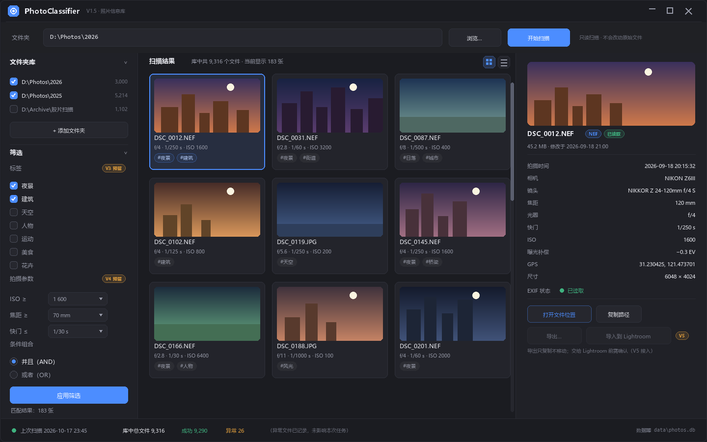
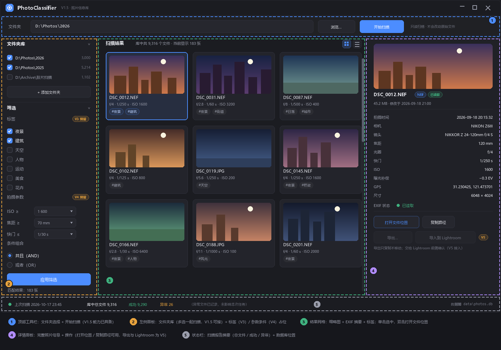
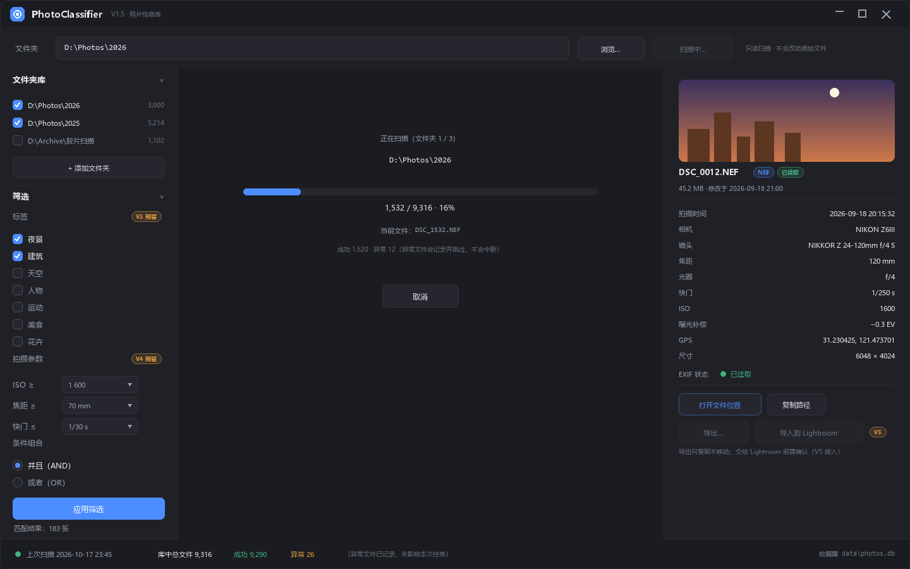

# PhotoClassifier UI 设计（V6 提前）

[English](ui-design.md) | [简体中文](ui-design.zh-CN.md)

> 状态：**待确认的设计稿** —— 本阶段只做视觉设计。按钮不必现在就有功能，
> 每个控件都标注了接入的版本。此步骤不写实现代码。

## 1. 目标

按新的开发次序，GUI 设计**提前**到 V2 规则分类之前。现在确定主窗口的最终
形态，让后续每个阶段（标签、筛选、导出）都能直接嵌入稳定布局，而第一版
可实现的 GUI 只需接上 V1.5 已有的能力（扫描、浏览、查看信息）。

延续规划文档的设计原则：

- **默认只读。** 界面中**没有任何删除按钮**——这是有意为之，对应"原片安全原则"。
- **渐进式呈现。** 属于后续版本的功能先画出占位并明确标注（"V3 预留"等），
  布局以后不需要推倒重排。
- **深色主题。** 与摄影后期工作流（Lightroom 类工具）一致。
- **中文界面优先**，所有文案集中管理，便于日后增加英文语言包。

## 2. 主窗口布局

| # | 区域 | 内容 | 接入版本 |
| --- | --- | --- | --- |
| 1 | **顶部工具栏** | 文件夹路径输入 + 「浏览…」+「开始扫描」；提示"只读扫描 · 不会改动原始文件" | V1.5（现在） |
| 2 | **文件夹库与筛选面板**（左） | **文件夹库**：列出所有已导入的文件夹（带照片数、复选框）——勾选的文件夹一起扫描；「+ 添加文件夹」。下方：标签复选框（夜景 / 建筑 / 天空 / 人物 / 运动 / 美食 / 花卉）、拍摄参数条件（ISO ≥、焦距 ≥、快门 ≤）、AND / OR 逻辑、「应用筛选」、实时匹配数量 | 文件夹库 = V1.5（现在）；标签 = V3、参数与逻辑 = V4 —— 先占位 |
| 3 | **结果网格**（中） | 缩略图卡片：预览图、文件名、一行 EXIF 摘要（光圈 · 快门 · ISO）、标签 chips；网格 / 列表视图切换；单击选中，双击打开文件位置 | 文件信息网格 = V1.5（现在）；缩略图与标签 chips = V3+ |
| 4 | **详情面板**（右） | 大预览图、文件名 + 格式/状态徽章、大小与修改时间、完整 EXIF 表（拍摄时间、相机、镜头、焦距、光圈、快门、ISO、曝光补偿、GPS、尺寸）、EXIF 状态；操作：「打开文件位置」「复制路径」（均为 V1.5）；「导出…」「导入到 Lightroom」（禁用，V5） | 信息 + 前两个按钮 = V1.5（现在） |
| 5 | **状态栏**（底） | 上次扫描时间、库内汇总（总文件数、成功数绿、异常数橙）+ 安抚说明、数据库位置 | V1.5（现在） |

## 3. 交互状态

### 扫描进行中

扫描运行时，结果区切换为进度视图：正在扫描哪个文件夹（「文件夹 1 / 3」）、
进度条（已处理 / 总数 · 百分比）、当前文件名、成功与异常的实时计数
（异常文件记录后跳过，绝不中断）、「取消」按钮。「开始扫描」按钮变为
禁用态的「扫描中…」。文件夹库中勾选的所有文件夹会依次扫描。

### 空状态（首次启动）

设计稿未画出：结果区显示友好说明（"选择文件夹并开始扫描——扫描过程只读"），
工具栏保持可用。实现时顺手加上即可。

### 错误展示

解析失败的文件在网格中带橙色「异常」徽章，详情面板显示 `exif_reader`
给出的具体错误信息——与 V1.5 的容错分级（损坏 / 无 EXIF / 非照片）一一对应。

## 4. 功能分期（什么什么时候能点）

| 阶段 | 变为可用的控件 |
| --- | --- |
| GUI V1.5（本设计确认后的第一版实现） | 文件夹库（添加文件夹、勾选参与扫描、多文件夹一起扫描）、扫描 + 实时进度、结果网格（文件信息）、详情面板、打开文件位置、复制路径、状态栏报告、统计对话框 |
| V3 | 标签复选框、卡片上的标签 chips、按标签筛选 |
| V4 | ISO / 焦距 / 快门条件、AND / OR 逻辑、「应用筛选」 |
| V5 | 「导出…」对话框（只复制不移动、明确确认）、「导入到 Lightroom」、批量选择 |
| V6+ | 列表视图打磨、偏好设置、界面本地化（英文） |

## 5. 技术选型（已决策）

**目标框架：PySide6（Qt）** —— 2026-10-18 确定。桌面控件成熟、高分屏支持好、
中文渲染好、Model/View 适合大量照片列表、PyInstaller 打包方便。将作为可选依赖引入，
核心程序继续保持零依赖。

> **实现说明（2026-10-18，GUI V1.5 外壳）**：当前开发环境无法访问 PyPI，
> 第一版可用外壳改用**标准库 Tkinter** 实现，布局与交互遵循本设计稿，
> 数据库层与扫描流程与界面无关、可完整复用；待环境允许安装 PySide6 时再迁移。
> Tkinter（零依赖但外观陈旧）与浏览器类方案（Electron / Flet）的取舍已在
> r1 评估过；本次属于环境受限下的务实选择，不是推翻原决策。

## 6. 待定问题（后续阶段处理）

1. **NEF 缩略图** —— NEF 内嵌 JPEG 预览图，大概率可以用同样的零依赖
   方式提取，GUI 实现阶段研究。在此之前卡片可显示按格式着色的占位图。
2. **窗口边框** —— 设计稿画的是自绘标题栏；实现时可直接用系统标题栏
   （更简单，建议 GUI 第一版这样做）。
3. **网格密度 / 卡片尺寸** —— 待真实照片库实测后调优。

## 7. 下一步

1. 用户确认本设计（或提出修改）。
2. 提交设计文档 + 设计稿图片。
3. 用 PySide6 实现 GUI 外壳，只接入 V1.5 能力；
   后续阶段的控件保持禁用并带版本标注。

## 8. 修订记录

- r3（2026-10-18）：**GUI V1.5 外壳已实现**（Tkinter，环境无法安装 PySide6；
  布局与交互按本设计稿），含文件夹库、后台扫描 + 进度 + 取消、结果列表、
  详情面板、打开文件位置 / 复制路径；筛选 / 导出 / Lightroom 为禁用占位。
  桌面快捷方式指向 `run_gui.pyw`。
- r2（2026-10-18）：左侧面板新增**文件夹库**（多文件夹浏览与多选一起扫描，
  GUI V1.5 即可接入）；「导出…」旁新增**导入到 Lightroom**（V5 占位）；
  GUI 框架决策确定（PySide6）。
- r1（2026-10-18）：初版设计。
